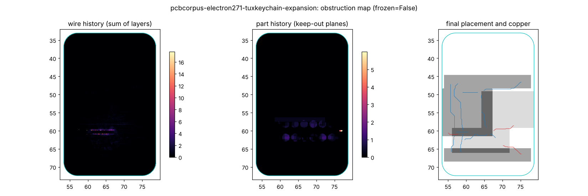

<!-- SPDX-FileCopyrightText: 2026 kicad-auto-everything contributors -->
<!-- SPDX-License-Identifier: CC-BY-4.0 -->
# Joint collapse by continuation (tag `jcollapse`)

Joint collapse from [layer-collapse](../../../docs/ideas/original/layer-collapse.md) on the pnr engine; code [jc.py](jc.py).

## Method as built

- **Lift (β = 0).** Parts at their own HPWL + 2·physics optimum (overlaps allowed); nets routed alone.
- **Collapse.** One β, one currency (cells of wire). Each iteration: (a) every net re-routes with PathFinder present cost β plus history; (b) every part jumps to its whole-board argmin over XY and 4 rotations of HPWL/g + 2·Δphysics/g + β·(1 + history)·(keep-out overlap + foreign route cells under its pads + hole/cutout conflicts). A cached-FFT engine makes a best response about 11 FFTs (15× cheaper than `Kit.overlap_map`). Pin tension (0.3) only from β ≥ 1; earlier it inflated HPWL 30 %.
- **Schedule.** β from 0.05, γ = 1.35, ×1.15 while conflict stalls, never slower than reaching β = 60 in the run budget; cap 500.
- **End.** Nearest legal pose (`Kit.legal_map` + hole/cutout checks, eviction), then PathFinder + `Router.legalize`.
- **Restarts.** Runs legalize at median β 2.3 (~10 iterations), so 85 % of the budget repeats the continuation and keeps the best (routed cost + 2·physics).
- **Variants.** `jc` adds a 15 % `anneal_phys` polish; `_lv`: phys_w = 0; `jc_full`: restarts judged also by 5·routed physics; `jc_frozen`: parts legalized after the lift, then frozen.

Failed: additive part history (poisons the best area), a 2 mm trust region (0–10 % worse). Two engine legality gaps surfaced and are priced in jc: PTH holes under a back-side courtyard, pads inside an unlocked footprint's Edge.Cuts frame.

## Results (33 A/B place tasks, 120 CPU-s, seed 0)

Length: 22 boards all runs completed. Physics: method/human, 10 physics boards. Full report: [score_final.md](score_final.md).

| Run | Legal | Clean | Completion | Length (mm) | Vias | Fast physics | Routed physics |
|---|---|---|---|---|---|---|---|
| `seq` | 0.788 | 0.545 | 0.863 | 3386 | 60 | 4.05 | 1.39 |
| `negotiate` | 0.818 | 0.545 | 0.897 | 3749 | 58 | 1.89 | 1.40 |
| `combo` | 0.848 | 0.636 | 0.897 | 2943 | 25 | 1.03 | 1.13 |
| `combo_lv` | 0.818 | 0.545 | 0.900 | 2948 | 28 | 2.59 | 1.26 |
| **`jc`** | **0.879** | **0.667** | 0.897 | 2977 | 42 | **0.82** | 1.05 |
| `jc_nopol` | 0.879 | 0.606 | 0.893 | **2928** | 48 | 0.86 | 1.00 |
| `jc_lv_nopol` | 0.879 | 0.667 | 0.897 | 3045 | 48 | 2.05 | 1.29 |
| `jc_frozen` | 0.879 | 0.485 | 0.892 | 4684 | 117 | 1.08 | 1.04 |
| `jc_full` (10 physics boards) | 8/10 | 4/10 | 0.943 | — | — | 0.84 | **0.80** |

- vs `combo`: shorter on 16/24 complete boards (0.93× gmean) but worse on large B boards (sum +1 %, vias +70 %); clean A 0.92 vs 0.85, B 0.50 both. More open hops (1.3 vs 0.5); with no open hop, routed physics 1.27 vs 1.22. `jc_full` beats human routed physics on 8/10.
- Polish: +2 clean boards, length 1.00×; the continuation carries the result.
- Schedule (dev6): γ = 2 with restarts ≈ default; one slow paced continuation is worse (completion 0.942, +9 % length, 2× vias). Restarts matter more: the first run is best on only 6/31 boards; best is 15 % cheaper (median).

## Joint vs frozen

Same lift, schedule, restarts and router, no polish; only whether parts answer β differs. Joint is shorter on **24 of 24** boards (gmean **0.52×**), 59 % fewer vias, clean 0.606 vs 0.485, equal legality: frozen parts force detours, moving parts dissolve conflicts. This supports the claim that the two are not separable. Routed physics ties (1.00 vs 1.04; spread copper is long but uncoupled).

## Obstruction maps

Wire and part history; also [0rax xiao](fig/pcbcorpus-0rax-esphome-xiao-base-pcb.png), [paw3395](fig/pcbcorpus-badjeff-paw3395-pcb-paw3395.png), [gas sensor](fig/d3a-kitspace-gas-sensor.png); all in `kae-work/jc-png/ab33-jc/`. Prices climb at dense pin rows (2×N header, castellated XIAO row, sensor-lens cutout edges): where L = 2 is too few for the evolving placement. Wire-history density predicts failure: median 4.3/mm² on incomplete vs 0.18 on complete boards (Mann–Whitney p = 0.046, n = 31).

## Verdict

**Merit, with caveats.** Best single-seed legality, clean and fast physics; ties `combo` on completion; `jc_full` best routed physics; joint-vs-frozen decisive. Caveats: one seed (`combo` clean varied 0.09 over seeds), more vias, weaker on large B boards, much gain from multi-start, `RoutedPhys` subprocess time is outside the CPU clock (as for `combo_full`).

## Next step

Three seeds of `jc`/`jc_full`; steer restarts by the obstruction map (re-rotate high-history parts with `collapse_obst.bus_lds`); price vias in the part cost; rank lifts with `collapse_assign.LiftedConflicts`.

Runs: `kae-work/results/jcollapse-{jc,jc_nopol,jc_lv_nopol,jc_frozen}-ab33-v3`, `jcollapse-jc_full-phys10-v3`, `jcollapse-jc_{fast,slow}-dev6-v2`; snapshots `kae-work/jc-snap/`.
